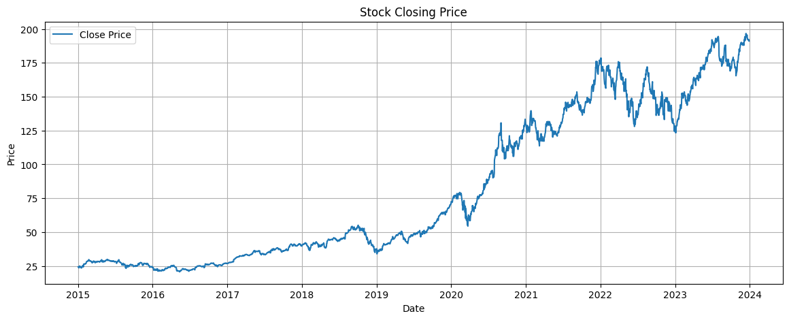
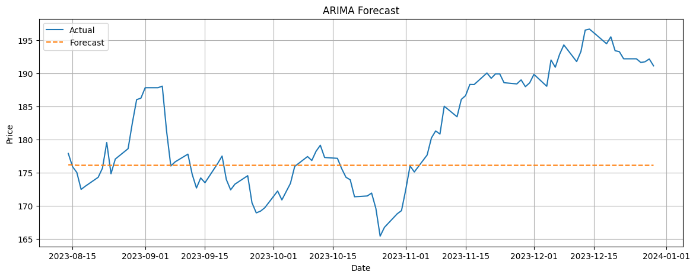
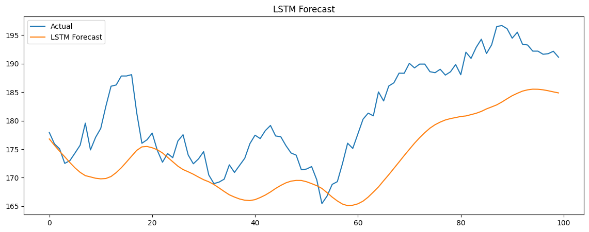
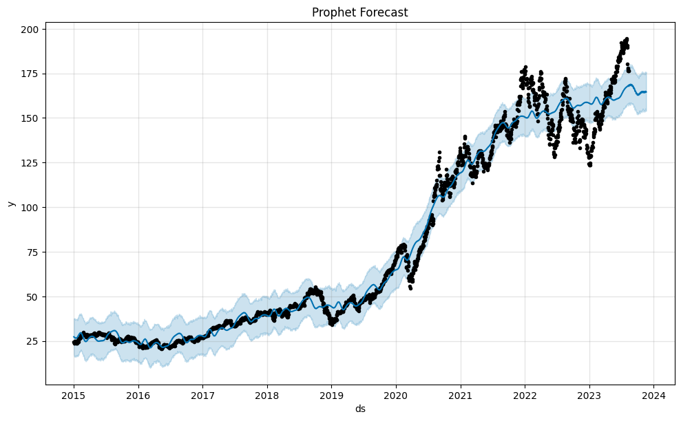
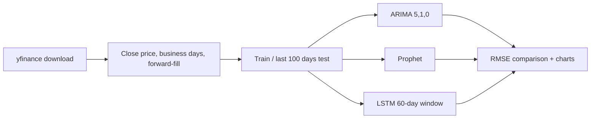

<div align="center">

# 📈 Stock Market Forecasting

**Comparing ARIMA, Prophet and LSTM for predicting stock closing prices**


[](https://colab.research.google.com/github/Gaganajain/Stock_Market_Forecasting_Project/blob/main/notebooks/Stock_Market_Forecasting_Project.ipynb)

</div>

---

## 📌 Overview

Which forecasting approach works best on real stock prices: a classical statistical model, an additive trend model, or a deep neural network?

This project downloads **Apple (AAPL) daily prices from 2015 to 2023**, holds out the **last 100 business days** as a test set, and compares three models by **RMSE** (root mean squared error):

| Model | Type | Idea |
|---|---|---|
| **ARIMA (5,1,0)** | Statistical | Uses past values and differencing to model the series |
| **Prophet** | Additive trend + seasonality | Meta's model for business time series |
| **LSTM** | Deep learning | Two stacked LSTM layers learn from 60-day windows |

## 🏆 Results (AAPL, last 100 business days)

| Rank | Model | RMSE ↓ |
|---|---|---|
| 🥇 | **LSTM** | **9.12** |
| 🥈 | ARIMA | 9.83 |
| 🥉 | Prophet | 18.04 |

The LSTM and ARIMA models track short-term movement closely; Prophet captures the long-term trend but misses day-to-day changes.

> Results from the notebook run. LSTM numbers vary slightly between runs because of random weight initialisation.

## 📸 Charts

**Closing price (2015 – 2023)**



| ARIMA | LSTM |
|---|---|
|  |  |

**Prophet**



## 🔄 Pipeline



## 📂 Project Structure

```
Stock_Market_Forecasting_Project/
├── notebooks/
│   └── Stock_Market_Forecasting_Project.ipynb   # Original Colab notebook with outputs
├── src/
│   └── forecast.py                              # Script version (any ticker, saves charts)
├── outputs/                                     # Forecast charts
├── requirements.txt
└── README.md
```

## 🚀 Getting Started

**Option 1: Google Colab** — click the *Open in Colab* badge above and run all cells.

**Option 2: Run locally**

```bash
git clone https://github.com/Gaganajain/Stock_Market_Forecasting_Project.git
cd Stock_Market_Forecasting_Project
pip install -r requirements.txt
python src/forecast.py
```

Try another stock or date range:

```bash
python src/forecast.py --ticker MSFT --start 2018-01-01 --end 2024-12-31 --epochs 10
```

## 🛠️ Tech Stack

| Area | Tools |
|---|---|
| Data | yfinance, Pandas, NumPy |
| Statistical model | statsmodels ARIMA |
| Trend model | Prophet |
| Deep learning | TensorFlow / Keras LSTM |
| Evaluation & charts | scikit-learn, Matplotlib |

## 🔮 Future Improvements

- Add technical indicators (moving averages, RSI, volume) as LSTM features
- Walk-forward validation instead of a single split
- Try GRU, Transformer and XGBoost models
- Streamlit dashboard to pick a ticker and view forecasts

> ⚠️ For learning purposes only. Not financial advice.

## 👩‍💻 Author

**Gagana Jain A** · [GitHub](https://github.com/Gaganajain)

⭐ If you found this useful, consider giving the repo a star!
